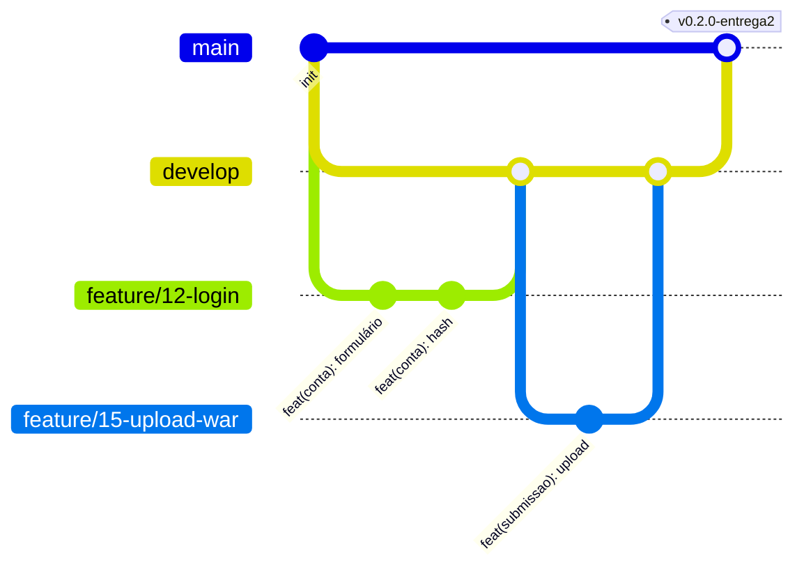

# Fluxo de trabalho Git / GitHub

Mesmo sendo o único contribuidor, o histórico conta como prova de trabalho contínuo.
O objectivo é que o professor abra o GitHub e veja: issues por requisito, branches por funcionalidade,
PRs com descrição, commits pequenos e uma tag por entrega.

## 1. Branches



| Branch | Uso | Regra |
|---|---|---|
| `main` | o que foi entregue ao professor | só recebe merge de `develop` (ou `hotfix/*`) na altura da entrega; protegida |
| `develop` | integração do trabalho em curso | recebe PRs das branches de trabalho |
| `feature/<nº-issue>-<descricao>` | funcionalidade nova | parte de `develop` |
| `fix/<nº-issue>-<descricao>` | correcção | parte de `develop` |
| `hotfix/<descricao>` | correcção urgente no que já foi entregue | parte de `main`, volta para `main` e `develop` |
| `docs/<descricao>` | só documentação | parte de `develop` |
| `chore/<descricao>` | build, configuração, dependências | parte de `develop` |

Nomes em minúsculas, com hífen: `feature/15-upload-war`.

## 2. Commits — Conventional Commits em português

```
<tipo>(<âmbito>): <resumo no imperativo, minúsculas, sem ponto final>

<corpo opcional: o porquê, não o como>

Refs #15
```

Tipos: `feat`, `fix`, `docs`, `style` (formatação), `refactor`, `test`, `chore`, `build`.
Âmbitos sugeridos: `conta`, `portal`, `submissao`, `deploy`, `monitor`, `admin`, `bd`, `infra`, `ui`.

Exemplos bons:
```
feat(submissao): valida versão do bytecode dos .war
fix(portal): corrige link para sistemas com hífen no slug
docs(integracao): explica migração javax para jakarta
chore(build): fixa maven.compiler.release em 17
```

Evitar: `update`, `alterações`, `fix bug`, `wip` em `develop`, commits com 40 ficheiros de assuntos diferentes, emojis.

Um commit = uma ideia. Se a mensagem precisa de "e", provavelmente são dois commits.

## 3. Issues, labels e milestones

- **Milestone** = uma entrega do professor (`Entrega 1 — 15/11`, `Entrega 2 — …`), com data.
- **Issue** = um requisito ou tarefa concreta (`TNN-R3: listar sistemas activos no portal`).
- **Labels:**

| Label | Cor sugerida | Uso |
|---|---|---|
| `tarefa-professor` | `#5319e7` | issue-mãe que guarda o enunciado |
| `feature` | `#0e8a16` | funcionalidade |
| `bug` | `#d73a4a` | erro |
| `docs` | `#0075ca` | documentação |
| `infra` | `#fbca04` | Tomcat, VM, BD, deploy |
| `polimento` | `#c5def5` | código/UI sem mudar comportamento |
| `integracao` | `#f9d0c4` | pedido de integração de um colega |

Criar tudo de uma vez com o GitHub CLI:
```powershell
gh label create tarefa-professor --color 5319e7 --description "Enunciado de uma tarefa do professor"
gh label create feature   --color 0e8a16
gh label create infra     --color fbca04
gh label create polimento --color c5def5
gh label create integracao --color f9d0c4 --description "Pedido de integração de um colega"
gh api repos/:owner/:repo/milestones -f title="Entrega 1" -f due_on="2026-11-15T23:59:00Z"
```

## 4. Pull Requests

Mesmo sozinho, abre PR de cada branch para `develop`:
```powershell
git push -u origin feature/15-upload-war
gh pr create --base develop --fill --label feature --milestone "Entrega 1"
gh pr merge --squash --delete-branch      # ou --merge, se quiseres manter os commits
```
A descrição segue `.github/PULL_REQUEST_TEMPLATE.md` e fecha issues com `Closes #15`.

## 5. Entregas: tags e releases (Semantic Versioning)

`vMAIOR.MENOR.CORRECÇÃO` — durante o semestre fica em `0.x`; a entrega final é `v1.0.0`.

```powershell
git checkout main
git merge --no-ff develop -m "release: entrega 2"
git tag -a v0.2.0 -m "Entrega 2 — submissão e validação de .war"
git push origin main --tags
gh release create v0.2.0 target\ROOT.war --title "Entrega 2" --notes-file docs\tarefas\T02-notas.md
```

Assim cada entrega tem o `.war` anexado e o professor consegue ver exactamente o que foi entregue em cada data.

## 6. Configuração inicial do repositório (uma vez)

```powershell
git init -b main
git add .
git commit -m "docs: contexto, requisitos e guias iniciais do projecto"
gh repo create plataforma-sos --private --source . --push
git checkout -b develop
git push -u origin develop
# proteger a main (exige PR para alterar, sem precisar de aprovação de outra pessoa)
gh api -X PUT repos/:owner/plataforma-sos/branches/main/protection `
  -F "required_pull_request_reviews[required_approving_review_count]=0" `
  -F enforce_admins=false -F required_status_checks=null -F restrictions=null
```

> Proteger branches em repositórios **privados** exige GitHub Pro — gratuito com o
> [GitHub Student Developer Pack](https://education.github.com/pack). Em repositório público funciona sem isso.

> Se o repositório for privado, adiciona o professor como colaborador (*Settings → Collaborators*) ou torna-o público na entrega.

## 7. O que nunca vai para o Git

Está no `.gitignore`: `target/`, `*.war` soltos, `META-INF/context.xml` real, `.env`, uploads, ficheiros do IDE.
Se uma password for commitada por engano: **troca a password** (apagar o commit não chega).
