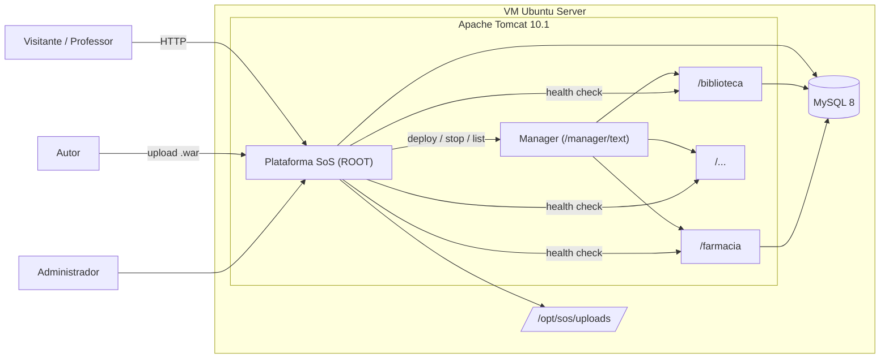
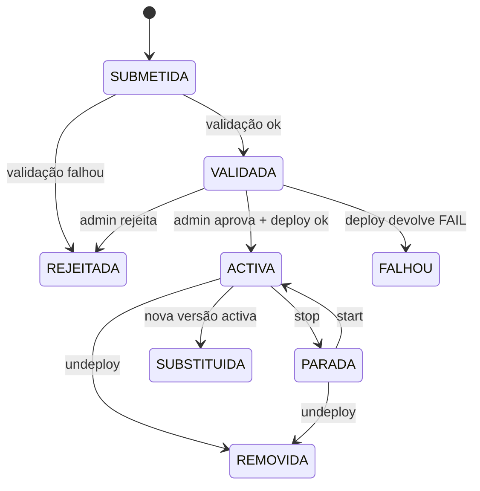
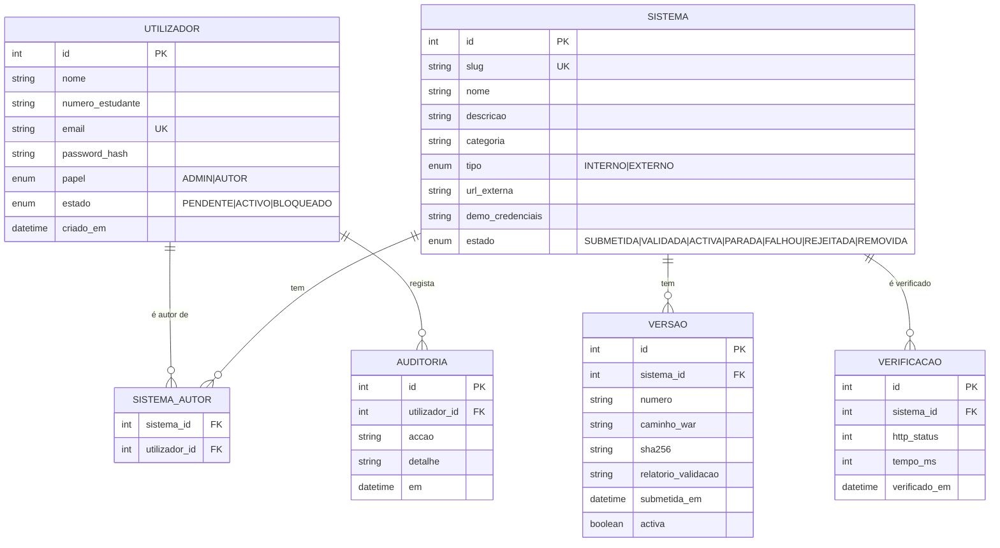

# Plataforma SoS — Documento de Requisitos

Versão 0.1 · Programação IV · Tema: Sistema de Sistemas

## 1. Visão

A turma produz vários sistemas web independentes (biblioteca, farmácia, gestão escolar, etc.).
Hoje cada um corre só no portátil do seu autor. A **Plataforma SoS** junta-os num único servidor:
cada colega submete o seu `.war`, a plataforma valida-o, implanta-o no Tomcat e publica-o num
portal comum, onde qualquer pessoa (professor, colegas, visitantes) os pode abrir e ver se estão no ar.

### 1.1 Porque é que isto é um Sistema de Sistemas

Usando as cinco características de Maier (1998), que convém citar na defesa:

| Característica | Como aparece no projecto |
|---|---|
| Independência operacional | Cada sistema funciona sozinho, tem a sua BD e o seu login. |
| Independência de gestão | Cada colega desenvolve e actualiza o seu sistema ao seu ritmo; a plataforma não controla o código deles. |
| Desenvolvimento evolutivo | Sistemas entram, saem e mudam de versão ao longo do semestre sem parar os outros. |
| Comportamento emergente | O portal, o estado agregado (quem está no ar), as estatísticas e o diretório comum só existem porque os sistemas estão juntos. |
| Distribuição geográfica | Os sistemas podem estar na VM local, na nuvem, ou ser registados como externos (URL). |

## 2. Actores

| Actor | Descrição |
|---|---|
| **Administrador** | Dono da plataforma. Aprova contas e submissões, faz deploy/stop/undeploy, vê logs. |
| **Autor (colega)** | Tem conta. Submete e actualiza o `.war` do seu sistema, vê o estado e o histórico. |
| **Visitante** | Sem conta. Vê o portal público e abre os sistemas activos. |
| **Tomcat** (sistema externo) | Executa os `.war`. Controlado via API `/manager/text`. |
| **Sistemas dos colegas** (externos) | Expõem opcionalmente `/health` e `WEB-INF/sos.properties`. |

## 3. Requisitos funcionais

Prioridade: **M** = obrigatório (MVP), **S** = deveria ter, **C** = se houver tempo.

### Contas e acesso
| ID | Requisito | Prio |
|---|---|---|
| RF01 | Registo de autor (nome, nº de estudante, email institucional, password). Conta fica *pendente*. | M |
| RF02 | Login/logout com sessão; passwords com hash. | M |
| RF03 | Administrador aprova/rejeita contas pendentes. | M |
| RF04 | Controlo de acesso por papel (ADMIN, AUTOR) via `Filter`. | M |
| RF05 | Recuperar password pelo administrador (reset manual). | C |

### Catálogo e portal
| ID | Requisito | Prio |
|---|---|---|
| RF10 | Portal público com a lista de sistemas activos: nome, autores, descrição, estado, link. | M |
| RF11 | Página de detalhe do sistema: descrição, versão, autores, credenciais de demonstração, histórico de versões. | M |
| RF12 | Pesquisa e filtro por nome, categoria e estado. | S |
| RF13 | Registar sistema **externo** (alojado noutro lado) apenas por URL. | S |
| RF14 | Estatísticas: nº de sistemas, % no ar, acessos por sistema. | C |

### Submissão e deploy
| ID | Requisito | Prio |
|---|---|---|
| RF20 | Autor submete `.war` + metadados (nome, slug, descrição, categoria, credenciais demo). | M |
| RF21 | Validação automática do `.war` (ver §6). Resultado guardado e mostrado ao autor. | M |
| RF22 | Administrador aprova a submissão; a plataforma faz deploy via `/manager/text/deploy`. | M |
| RF23 | Administrador pode *parar*, *iniciar*, *recarregar* e *remover* um sistema. | M |
| RF24 | Nova versão do mesmo sistema substitui a anterior (`update=true`) e fica no histórico. | S |
| RF25 | Rollback para a versão anterior guardada. | C |
| RF26 | Autor submete script `.sql`; admin cria a BD `sos_<slug>` e o utilizador MySQL respectivo. | S |

### Monitorização
| ID | Requisito | Prio |
|---|---|---|
| RF30 | Health check periódico (ex.: 60 s) a cada sistema activo: `GET /<slug>/health` ou `/<slug>/`. | M |
| RF31 | Estado visível no portal: *No ar*, *Lento*, *Em baixo*, *Parado*. | M |
| RF32 | Sincronizar estado real com `GET /manager/text/list`. | S |
| RF33 | Registo de auditoria: quem fez o quê e quando (login, submissão, deploy, stop). | S |

## 4. Requisitos não funcionais

| ID | Requisito |
|---|---|
| RNF01 | Corre em Tomcat 10.1 com Java 21; a plataforma é implantada como `ROOT.war`. |
| RNF02 | Interface em português, responsiva (≥ 360 px), sem dependência de CDN (funciona sem internet na sala). |
| RNF03 | Segurança: `PreparedStatement`, hash de passwords, escape de output, CSRF em POST, sessão com `HttpOnly`, timeout 30 min. |
| RNF04 | Credenciais (BD, Tomcat Manager) fora do código: `META-INF/context.xml` local não versionado ou variáveis de ambiente. |
| RNF05 | Um sistema de colega que falhe no arranque não pode derrubar a plataforma (deploy isolado; ver §8). |
| RNF06 | Tamanho máximo de `.war`: 50 MB. |
| RNF07 | Ficheiros submetidos guardados fora da pasta da aplicação (`/opt/sos/uploads`), para não se perderem em redeploy. |
| RNF08 | Código versionado no GitHub com o fluxo de `docs/GIT-WORKFLOW.md`; cada entrega tem tag. |

## 5. Arquitectura



### 5.1 Camadas e pacotes

```
src/main/java/ao/sos/hub/
├── controller/   Servlets (@WebServlet) — recebem o pedido, chamam o service, encaminham para a JSP
├── service/      Regras de negócio (SubmissaoService, DeployService, ContaService...)
├── dao/          Acesso a dados com JDBC (UtilizadorDAO, SistemaDAO, VersaoDAO...)
├── model/        Entidades simples (Utilizador, Sistema, Versao, Verificacao, Auditoria)
├── infra/        TomcatManagerClient, ValidadorWar, MonitorSaude (agendador)
├── filter/       AutenticacaoFilter, CsrfFilter, EncodingFilter
└── util/         Hash de passwords, Flash messages, etc.
src/main/webapp/
├── WEB-INF/views/   JSP (publico/, autor/, admin/, partials/)
├── WEB-INF/web.xml
├── META-INF/context.xml   (DataSource JNDI — versão de exemplo no repo, real fora)
└── static/          css/, js/, img/
```

### 5.2 Fluxo de submissão



## 6. Validação automática do `.war` (RF21)

| # | Verificação | Como | Falha = |
|---|---|---|---|
| V1 | É um ZIP válido e ≤ 50 MB | `java.util.zip.ZipFile` | erro |
| V2 | Tem `WEB-INF/` | procurar entradas | erro |
| V3 | Usa Jakarta (não `javax.servlet`) | `web.xml` com namespace `jakarta.ee`; procurar a string `javax/servlet` nos `.class` | erro (ou aviso, se activo o modo legado — ver guia) |
| V4 | Bytecode ≤ Java 21 | bytes 6–7 de cada `.class`: *major version* ≤ 65 | erro |
| V5 | Tem `WEB-INF/sos.properties` com campos obrigatórios | `java.util.Properties` | aviso |
| V6 | Slug válido, único, não reservado | regex `^[a-z][a-z0-9-]{2,30}$`; lista reservada: `manager`, `host-manager`, `api`, `static`, `admin`, `docs`, `examples` | erro |
| V7 | Tem driver JDBC em `WEB-INF/lib` se declarar BD | procurar `mysql-connector-j*.jar` | aviso |
| V8 | Não contém `META-INF/context.xml` com credenciais de outras BD | ler o ficheiro | aviso |

## 7. Modelo de dados (inicial)



## 8. Isolamento e riscos

Um `.war` corre **dentro da mesma JVM** que o Tomcat: tem acesso total ao servidor. Por isso:

1. **Só contas aprovadas** submetem; **só o administrador** faz deploy.
2. Tudo corre numa **VM dedicada** (nunca no teu portátil pessoal em produção).
3. **Fase 2 recomendada:** duas instâncias Tomcat na mesma VM (`CATALINA_BASE` separados):
   - instância A (porta 8080): só a plataforma;
   - instância B (porta 8081): só os sistemas dos colegas, com `-Xmx` limitado.
   Se um sistema esgotar a memória, só cai a instância B. Um Nginx à frente junta tudo na porta 80.
4. Backups diários da BD (`mysqldump`) e da pasta `/opt/sos/uploads`.

## 9. Fora de âmbito (por agora)

- Contentores por sistema (Docker por colega) — fica no roadmap.
- Build a partir do código-fonte dos colegas (eles entregam o `.war` já compilado).
- SSO entre a plataforma e os sistemas dos colegas.

